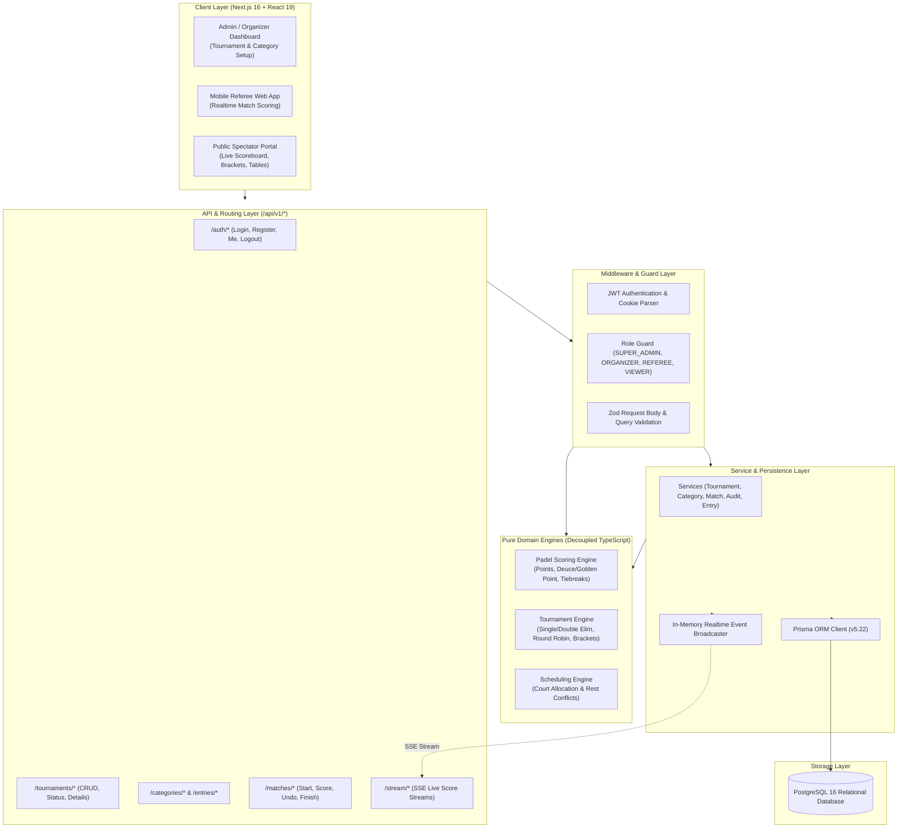

# Padel Tournament OS - Architecture Documentation

## 1. System Architecture

## 2. Relational Data Model

1. **Users & Permissions**:
   - `users`: User identity, password hashes (bcrypt 12 rounds), roles (`SUPER_ADMIN`, `ORGANIZER`, `REFEREE`, `VIEWER`).
   - `tournament_members`: Scoped roles per tournament (`OWNER`, `ADMIN`, `REFEREE`).

2. **Competition Organization**:
   - `tournaments`: Tournaments with lifecycle states (`DRAFT`, `REGISTRATION`, `PUBLISHED`, `IN_PROGRESS`, `COMPLETED`, `ARCHIVED`).
   - `categories`: Competition categories (e.g. "Men's Advanced", "Mixed Doubles") with formats (`SINGLE_ELIMINATION`, `ROUND_ROBIN`, `GROUP_KNOCKOUT`, etc.).
   - `rulesets`: Per-category padel rules (sets to win, games per set, tiebreak rules, golden point vs. advantage, super tiebreak).
   - `courts`: Physical courts per tournament with active status and priority.

3. **Athletes & Entries**:
   - `players`: Individual padel athletes with contact information and ratings.
   - `entries`: Competition team/pairs (e.g. "Player 1 / Player 2") with seeds and statuses.
   - `entry_players`: Pivot linking pairs to individual players (supports both fixed pairs and rotating formats).

4. **Competition Stages, Groups & Matches**:
   - `stages`: Tournament phases (Group stage, Knockout bracket).
   - `groups`: Pools within group stages.
   - `matches`: Individual encounters with court assignments, timestamps, and optimistic concurrency version numbers.
   - `match_officials`: Assigned referees for each match.
   - `match_sets`: Set-by-set game tally and tiebreak markers.
   - `match_events`: Append-only event store for every scoring action, undo, and correction.
   - `match_score_snapshots`: Fast-read projection of the current match score state.
   - `bracket_slots`: Binary bracket tree positions and bye placeholders.
   - `standings`: Realtime group standings computed from match results.

5. **Integrity & Concurrency**:
   - `audit_logs`: Detailed audit trail of administrative modifications.
   - `idempotency_keys`: Prevents double-scoring actions over flaky network connections.

## 3. Concurrency & Realtime Synchronization

- **Optimistic Concurrency**: Match updates require client to send the current match `version`. If the version in the database has progressed (e.g. another official or retry updated it), the mutation rejects with a 409 conflict, prompting the client to refresh state.
- **Idempotency**: Referees submit a client-generated UUID for each scoring operation. If the server receives duplicate packets, the cached result is returned without double-counting points.
- **SSE Broadcasting**: Live scores are streamed via Server-Sent Events (`/api/v1/stream/tournaments/:id`), eliminating unnecessary polling while maintaining low latency.
